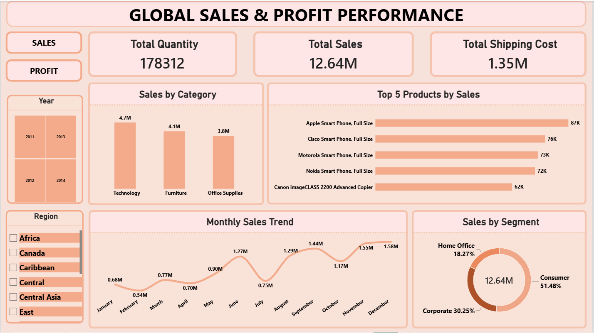
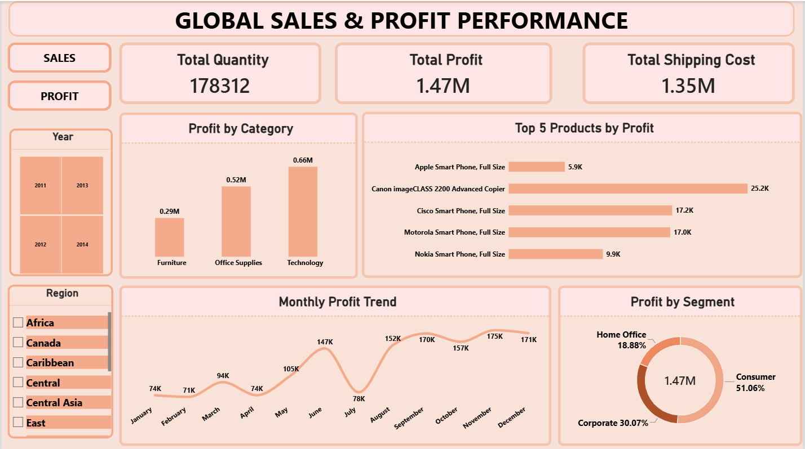
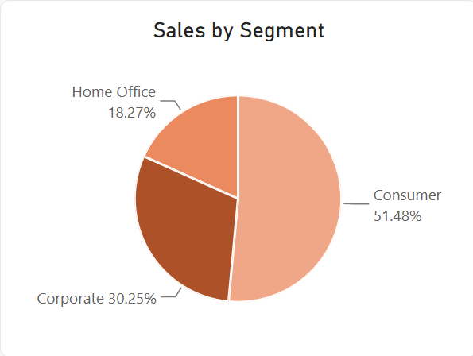
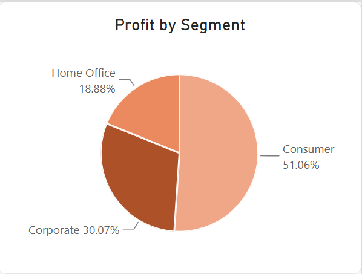
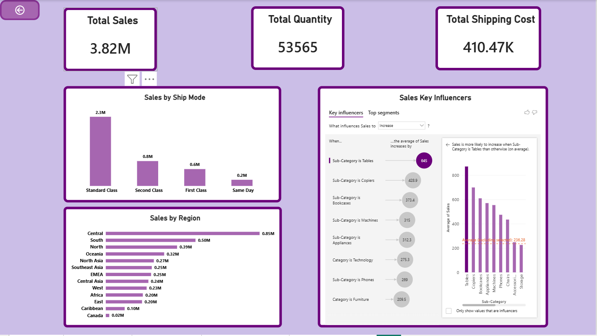
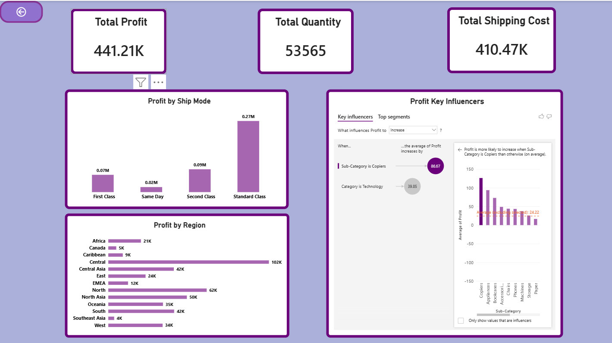
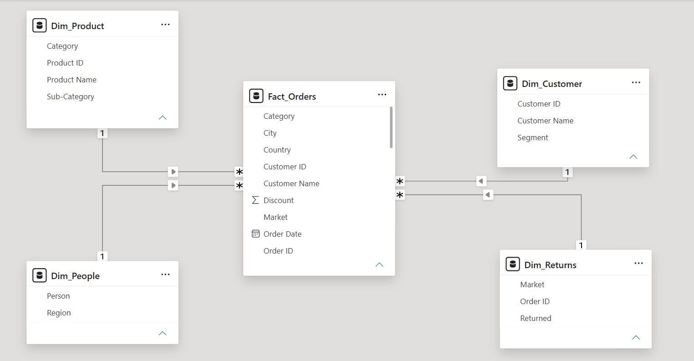

# Global Sales & Profit Performance Dashboard

## 📊 Project Overview

An interactive **Power BI dashboard** designed to analyze global sales and profit performance. It helps users explore product and category performance, monthly trends, customer segments, shipping costs, and regional performance through interactive visualizations.

The dashboard includes dedicated **Sales** and **Profit** views, with bookmarks, slicers, report tooltips, drillthrough analysis, and Key Influencers visuals for deeper exploration.

## 🛠️ Tools & Technologies

- Microsoft Power BI Desktop
- Power Query
- Data Modeling and Relationships
- Data Visualization
- Bookmarks and Interactive Slicers
- Report Tooltips and Drillthrough
- Key Influencers Visual

## 📌 Key Performance Indicators (KPIs)

- **Total Sales:** 12.64M
- **Total Profit:** 1.47M
- **Total Quantity:** 178,312
- **Total Shipping Cost:** 1.35M

*These values reflect the overview screenshots; visuals can change based on filter selections.*

## 📈 Dashboard Features

### Sales Overview
- Sales by Category: Technology, Furniture, and Office Supplies
- Top 5 Products by Sales
- Monthly Sales Trend
- Sales by Customer Segment
- Year and Region slicers

### Profit Overview
- Profit by Category
- Top 5 Products by Profit
- Monthly Profit Trend
- Profit by Customer Segment
- Bookmarks for switching between Sales and Profit views

### Advanced Analysis
- **Report Tooltips:** Sales and Profit breakdowns by customer segment
- **Drillthrough Pages:** Detailed Sales and Profit analysis by Ship Mode and Region
- **Key Influencers:** Explore factors associated with changes in Sales and Profit

## 📸 Dashboard Screenshots

### 1. Sales Overview

### 2. Profit Overview

### 3. Sales Tooltip

### 4. Profit Tooltip

### 5. Sales Drillthrough

### 6. Profit Drillthrough

### 7. Data Model

## 🗂️ Data Model

The Power BI model uses a central fact table with related dimension tables:

- **Fact_Orders** – Order and transaction data
- **Dim_Product** – Product details and categories
- **Dim_Customer** – Customer details and segments
- **Dim_People** – People and regional information
- **Dim_Returns** – Order return information

The relationships between these tables support cross-table reporting and analysis.

## 🎯 Project Objective

To turn global sales data into interactive, easy-to-understand business insights, compare Sales and Profit performance, and support data-driven decision-making.

## ▶️ How to Use

1. Download `Global_Sales_Profit_Performance_Dashboard.pbix` from this repository.
2. Open the file in Microsoft Power BI Desktop.
3. Switch between Sales and Profit views using the dashboard bookmarks.
4. Use the Year and Region slicers to explore different segments of the data.
5. Hover over charts for tooltips and use drillthrough to examine more detailed results.

## 👩‍💻 Author

**Atiya Dabir**

*This portfolio project was created for learning and demonstrating Power BI reporting, data modeling, and data analysis skills.*
